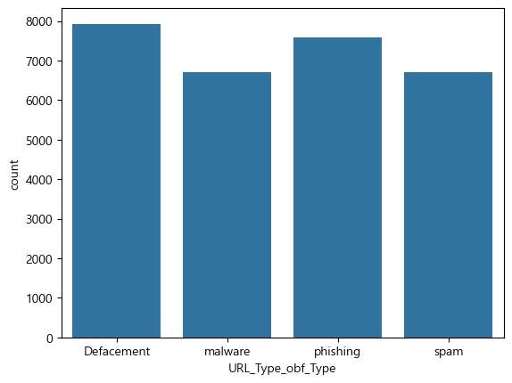
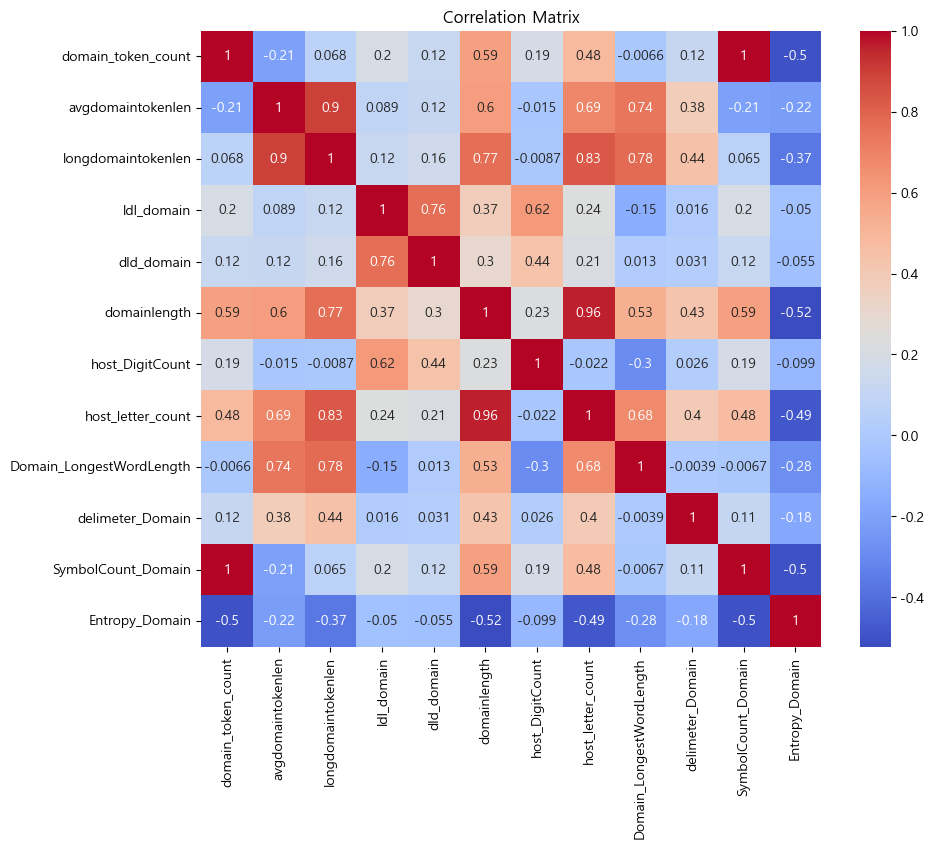
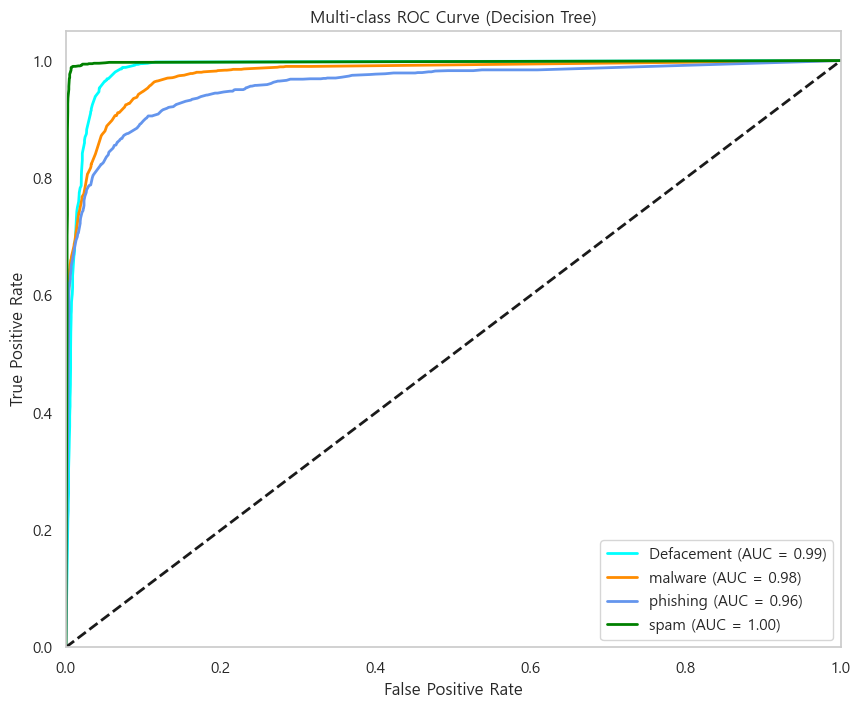
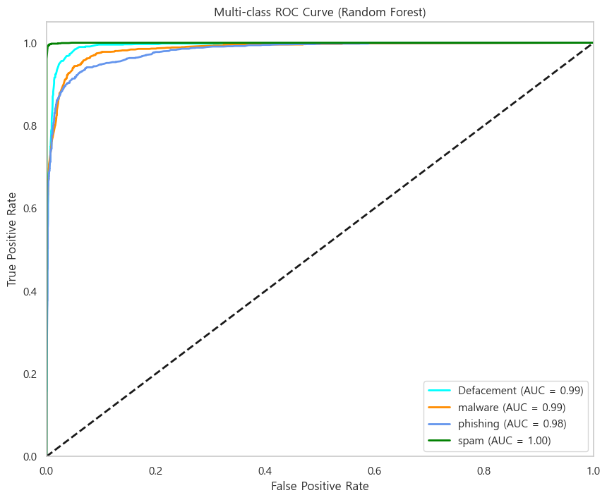
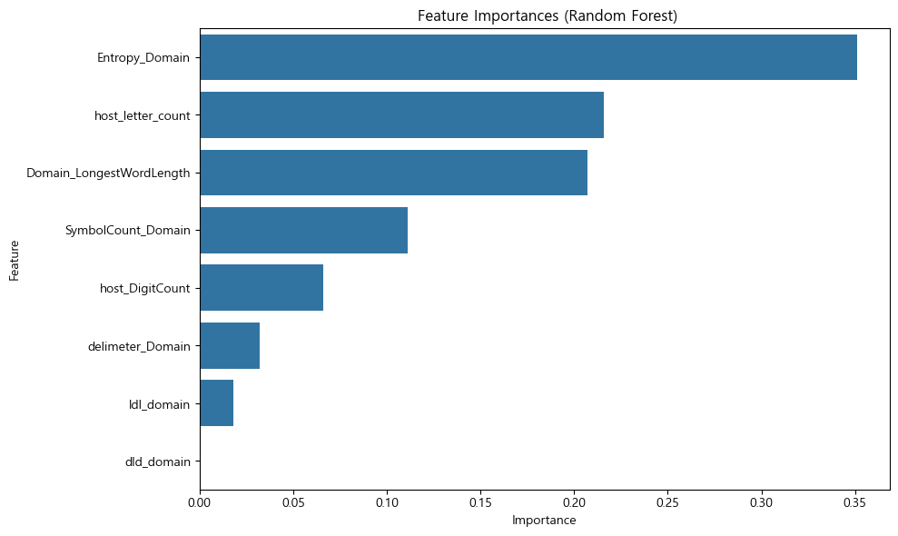

# 🛡️ 도메인 기반 악성 URL 공격 유형 다중 분류

> URL의 **도메인 부분에서 뽑은 특징 8개만으로** 악성 URL이 어떤 공격 유형(Defacement · malware · phishing · spam)인지 분류합니다.

`2025.05` · 서울여자대학교 데이터사이언스학과 「머신러닝 기반 데이터 분석」 팀 프로젝트 (팀 WD)

📑 [발표 자료 (PDF)](제출%20파일/머신러닝기반데이터분석_WD_PPT.pdf)

<br>

## 📌 문제 정의

한국인터넷진흥원(KISA)의 「2024 하반기 사이버 위협 동향 보고서」에 따르면, 2024년 침해사고 신고는 전년보다 크게 늘었습니다. 유형별로는 **서버 해킹이 56%로 가장 많았고**, DDoS 공격(15.1%), 악성코드 감염(12.1%), 랜섬웨어(10.3%)가 뒤를 이었습니다. 보고서는 보안이 취약한 중소기업 홈페이지를 노린 웹 공격이 늘어난 점을 원인으로 꼽았습니다.

공격 유형마다 대응 방법이 다르기 때문에, 악성 URL은 "악성인가, 아닌가"를 넘어 **어떤 유형의 공격인지**까지 구분할 수 있어야 합니다.

### 왜 도메인인가

URL은 `protocol://domain:port/path?query#fragment` 구조로 이루어져 있습니다. 이 중 **도메인**은 URL이 어느 서버로 연결되는지를 결정하는 부분입니다. 무작위로 생성된 문자열, 숫자, 특수기호처럼 공격용 도메인에 자주 나타나는 특징을 이 부분에서 살펴볼 수 있습니다.

그래서 이 프로젝트는 **도메인 특징만으로 공격 유형을 얼마나 구분할 수 있는지** 확인했습니다.

<br>

## 🗂️ 데이터셋

**[ISCX-URL2016](https://www.unb.ca/cic/datasets/url-2016.html)** (Canadian Institute for Cybersecurity, UNB)의 `All.csv`를 사용했습니다.

| 항목 | 내용 |
| --- | --- |
| 전체 | 36,707행 × 80열 (URL에서 미리 추출된 어휘적 특징) |
| 타깃 | `URL_Type_obf_Type`: benign, Defacement, phishing, malware, spam |
| 사용 데이터 | 공격 유형 분류가 목적이라 **benign(정상) 7,781행을 제외한 28,926행** |

| 클래스 | 개수 |
| --- | ---: |
| Defacement | 7,930 |
| phishing | 7,586 |
| malware | 6,712 |
| spam | 6,698 |

클래스 분포가 고르게 나뉘어 있어서 따로 리샘플링은 하지 않았습니다.

<p align="center"></p>

<br>

## 🔧 y = f(X)

**y**: `URL_Type_obf_Type`, 즉 악성 URL의 공격 유형 4가지

**X**: 도메인 관련 특징 12개로 시작했습니다. 상관계수가 지나치게 높은 쌍에서 하나씩 제거해 **8개**를 남겼습니다.

| 특징 | 의미 |
| --- | --- |
| `Entropy_Domain` | 도메인 문자열의 엔트로피(무작위성). `a8d9k3l.com`처럼 무작위로 만든 도메인일수록 높음 |
| `host_letter_count` | 도메인의 알파벳 개수 |
| `Domain_LongestWordLength` | 도메인에서 가장 긴 단어의 길이 |
| `SymbolCount_Domain` | 도메인의 특수기호 개수 |
| `host_DigitCount` | 도메인의 숫자 개수 |
| `delimeter_Domain` | 도메인의 구분자(`-`, `_` 등) 개수 |
| `ldl_domain` | 도메인에서 문자-숫자-문자 패턴의 개수 |
| `dld_domain` | 도메인에서 숫자-문자-숫자 패턴의 개수 |

제거한 특징은 `domain_token_count`, `avgdomaintokenlen`, `longdomaintokenlen`, `domainlength`입니다. 모두 도메인 길이와 강하게 상관된 중복 정보였습니다.

<p align="center"></p>

<br>

## ⚙️ 분석 과정

1. **결측치 확인**: 이 데이터셋은 결측을 `-1`로 표시합니다. 선택한 도메인 특징에는 `NaN`도 `-1`도 없었습니다.
2. **변수 선택**: 상관계수 히트맵을 기준으로 중복 특징을 제거해 12개에서 8개로 줄였습니다.
3. **정상 URL 제외**: benign을 빼고 공격 유형 4개만 남겼습니다.
4. **표준화**: `StandardScaler`
5. **분할**: 학습 80%, 테스트 20% (`random_state=42`)
6. **모델링**: Decision Tree와 Random Forest
7. **해석**: 전체 변수 중요도, 그리고 클래스별 One-vs-Rest Permutation Importance(F1 기준)

<br>

## 📊 결과

### 전체 성능 (테스트셋 5,786건)

| 모델 | Accuracy | Macro F1 |
| --- | ---: | ---: |
| Decision Tree (`max_depth=20`, `min_samples_leaf=5`) | 0.90 | 0.90 |
| **Random Forest** (`max_depth=20`) | **0.93** | **0.93** |

### 클래스별 F1 · AUC

| 클래스 | DT F1 | RF F1 | DT AUC | RF AUC |
| --- | ---: | ---: | ---: | ---: |
| spam | 0.98 | **0.99** | 1.00 | 1.00 |
| Defacement | 0.92 | **0.94** | 0.99 | 0.99 |
| malware | 0.87 | **0.90** | 0.98 | 0.99 |
| phishing | 0.84 | **0.90** | 0.96 | 0.98 |

<p align="center">
  
  
</p>

### 변수 중요도 (Random Forest)

| 순위 | 특징 | 중요도 |
| ---: | --- | ---: |
| 1 | `Entropy_Domain` | 0.351 |
| 2 | `host_letter_count` | 0.216 |
| 3 | `Domain_LongestWordLength` | 0.207 |
| 4 | `SymbolCount_Domain` | 0.111 |
| 5 | `host_DigitCount` | 0.066 |
| 6 | `delimeter_Domain` | 0.032 |
| 7 | `ldl_domain` | 0.018 |
| 8 | `dld_domain` | 0.000 |

<p align="center"></p>

### 클래스별로 중요한 특징 (Permutation Importance, 상위 3개)

| 클래스 | Decision Tree | Random Forest |
| --- | --- | --- |
| Defacement | Entropy · letter_count · LongestWord | letter_count · Entropy · LongestWord |
| malware | Entropy · letter_count · LongestWord | LongestWord · letter_count · Entropy |
| phishing | LongestWord · Entropy · letter_count | LongestWord · Entropy · letter_count |
| spam | Entropy · **SymbolCount** · letter_count | Entropy · letter_count · **SymbolCount** |

<br>

## 💡 결론

- **Random Forest가 Decision Tree보다 모든 클래스에서 더 좋았습니다.** 정확도는 0.90에서 0.93으로 올랐습니다.
- 두 모델 모두 **spam > Defacement > malware > phishing** 순으로 잘 맞혔습니다. spam은 데이터가 가장 적은데도 F1이 0.98~0.99로 가장 높았습니다.
- **phishing이 가장 어려웠습니다.** 피싱 도메인은 정상 서비스처럼 보이도록 만들어지기 때문에, 도메인 모양만으로는 malware나 Defacement와 헷갈리기 쉽습니다. 혼동 행렬에서도 phishing → Defacement·malware 오분류가 가장 많았습니다.
- **도메인 엔트로피가 가장 중요한 특징**이었습니다. 도메인이 얼마나 무작위적인지가 공격 유형을 가르는 핵심 신호라는 뜻입니다. phishing에서는 가장 긴 단어 길이가 1위였는데, 실제 브랜드명을 흉내 내는 피싱 도메인의 특성과 맞아떨어집니다.
- spam에서는 특수기호 개수가 상위권에 올랐습니다. 다른 클래스와 구분되는 spam만의 신호입니다.
- `dld_domain`은 두 모델 모두에서 중요도가 0이었습니다. 이 특징을 빼고 다시 모델링해 성능을 비교해 볼 필요가 있습니다.

<br>

## 🔍 시도했던 방향

최종 모델에 오기까지 아래 방향도 실험했습니다. 관련 노트북은 루트 폴더와 `파일 확인/` 폴더에 있습니다.

- **Kaggle 데이터셋으로 확장**: [Malicious URLs dataset](https://www.kaggle.com/datasets/sid321axn/malicious-urls-dataset)(`malicious_phish.csv`)의 원본 URL에서 `tldextract`로 도메인 토큰 수, 엔트로피, 숫자 비율 같은 특징을 직접 추출해 ISCX 데이터와 합쳐 보았습니다.
- **다른 변수 선택 방법**: VIF로 다중공선성 기준 변수 선택, 특수기호 개수·숫자 비율·엔트로피 단독 모델링
- **교차 검증**: Decision Tree에 10-Fold 교차 검증 적용

URL 전체 특징을 쓰면 정확도가 더 높았지만, **"도메인만으로 공격 유형을 가를 수 있는가"라는 질문에 집중하려고** 최종 모델은 도메인 특징으로 제한했습니다.

<br>

## 🚧 개선할 점

- `dld_domain`처럼 중요도가 0인 특징을 제거한 뒤 성능 비교
- 하이퍼파라미터 튜닝(GridSearchCV 등)과 Gradient Boosting 계열 모델 비교
- 표준화를 학습셋에만 맞추도록(`fit`) 파이프라인 정리. 트리 모델은 스케일 영향을 거의 받지 않지만, 다른 모델로 확장할 때 필요합니다.
- 특징값이 완전히 같은 행이 학습셋과 테스트셋에 동시에 들어갈 수 있으므로, 중복 제거 후 다시 평가

<br>

## 📁 파일 구성

```text
├── 제출 파일/
│   ├── ML_WD_ROC포함.ipynb            ⭐ 최종 분석 노트북 (ROC 곡선 포함)
│   ├── ML_WD.ipynb / ML_WD.html       최종 분석 노트북 (ROC 이전 버전)
│   ├── 머신러닝기반데이터분석_WD_PPT.pdf  발표 자료
│   └── All.csv                        ISCX-URL2016 데이터
│
├── 파일 확인/                         변수 탐색 (VIF, 엔트로피, 숫자 비율, 특수기호 개수)
├── 캐글 자료 컬럼 만들기 + 첫 데이터 합쳐서 모델링.ipynb   Kaggle 데이터 특징 추출 · 병합
├── Decision_Tree_KFold.ipynb          10-Fold 교차 검증
├── for_modeling_3_maker.ipynb         모델링용 데이터 만들기
└── images/                            README 그림
```

### 실행

```bash
pip install pandas numpy matplotlib seaborn scikit-learn
jupyter notebook "제출 파일/ML_WD_ROC포함.ipynb"
```

노트북의 한글 폰트 설정은 Windows의 맑은 고딕(`C:/Windows/Fonts/malgun.ttf`) 기준입니다.

<br>

## 👥 팀 WD

| 이름 | 소속 |
| --- | --- |
| 박수민 | 서울여자대학교 데이터사이언스학과 |
| 장예서 | 서울여자대학교 데이터사이언스학과 |
| 전서연 | 서울여자대학교 데이터사이언스학과 |

<br>

## 📚 참고문헌

- 한국인터넷진흥원(KISA), 「2024 하반기 사이버 위협 동향 보고서」
- 김윤정, 김문선, 이만희. (2022). 유사성 해시 기반 악성코드 유형 분류 기법. 『정보보호학회논문지』, 32(5), 945–954.
- 김영준, 이재우. (2022). URL 주요특징을 고려한 악성URL 머신러닝 탐지모델 개발. 『한국정보통신학회논문지』, 26(12), 1786–1793.
- Baskota, S. (2025). Phishing URL Detection using Bi-LSTM. *arXiv preprint* arXiv:2504.21049.
- Mamun, M. S. I., Rathore, M. A., Lashkari, A. H., Stakhanova, N., & Ghorbani, A. A. (2016). Detecting Malicious URLs Using Lexical Analysis. *NSS 2016*. (ISCX-URL2016 데이터셋)
